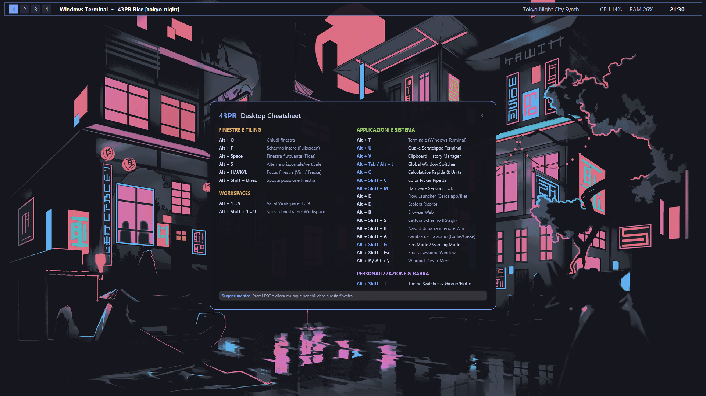
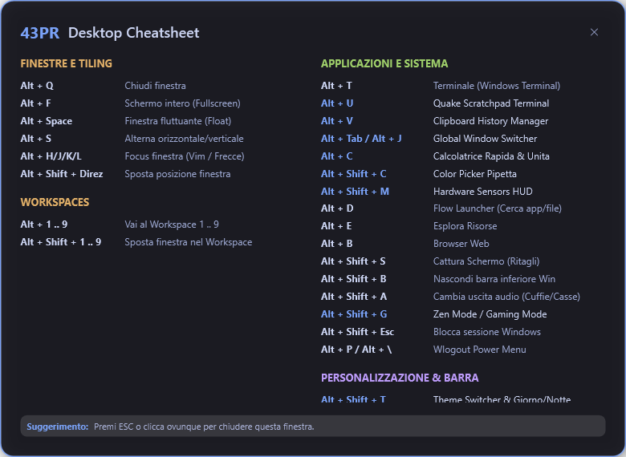
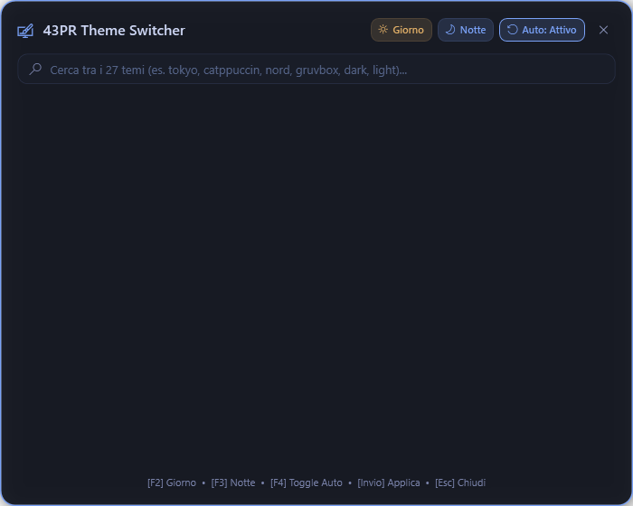
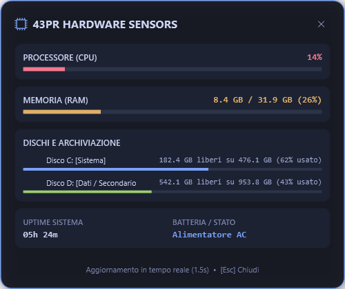
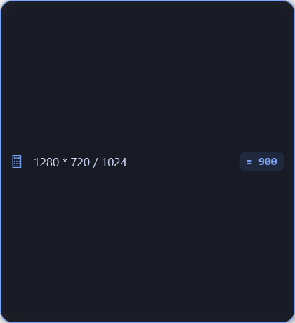
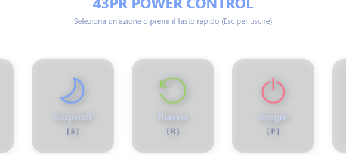

# 43PR Rice for Windows 10 / 11

> 🇮🇹 **Disponibile in Italiano:** [Documentazione in Italiano](README.it.md)



A minimalist, highly performant tiling window manager and desktop environment for Windows, powered by **GlazeWM**, **Zebar**, and native **WPF / C#** utilities.

Designed for productivity, keyboard navigation, and pure aesthetics with 27 harmonized themes, an automatic day/night circadian switcher, a native HUD suite, and zero terminal popup latency.

---

## Quick Install (One-Liner)

Open **PowerShell** (no admin required) and run:

```powershell
irm https://raw.githubusercontent.com/amedello/43pr-rice-windows/master/install.ps1 | iex
```

The installer will:
1. Verify and automatically install prerequisites via `winget` (GlazeWM, Zebar, Starship, Fastfetch, JetBrains Mono Nerd Font).
2. Compile the high-performance native controller (`media-ctl.exe`) using Windows' built-in .NET compiler.
3. Deploy GlazeWM and Zebar configurations and custom widgets to `~/.glzr`.
4. Configure Windows Terminal, PowerShell profiles, system dark mode, and Tokyo Night accent.
5. Create an optional autostart shortcut in `shell:startup`.

---

## Manual Installation (Local Clone)

If you prefer to clone the repository manually:

```powershell
# Clone the repository
git clone https://github.com/amedello/43pr-rice-windows.git
cd 43pr-rice-windows

# Run the installer
powershell -ExecutionPolicy Bypass -File .\install.ps1
```

---

## Features

- **Tiling Window Management**: Powered by [GlazeWM](https://github.com/glzr-io/glazewm) (i3/bspwm-like workflow for Windows).
- **Zebar Top Bar**: Clean status bar displaying workspaces, current window title, interactive media player controls, CPU/RAM meters, battery/network, and clock.
- **27 Harmonized Themes**: Tokyo Night, Catppuccin (Mocha & Latte), Nord, Gruvbox, Dracula, Everforest, Kanagawa, Rose Pine, One Dark, Monokai, Matrix, Solarized, and more.
- **Circadian Day / Night Switcher**: Automatically switches between day theme (e.g. Catppuccin Latte) at 07:00 and night theme (Tokyo Night) at 19:00, or switch manually via <kbd>Alt</kbd> + <kbd>Shift</kbd> + <kbd>T</kbd>.
- **Zero Console Popups**: Every launcher and helper compiles to a native Windows subsystem (`winexe`) or runs with `-WindowStyle Hidden`, preventing annoying black terminal flashes.
- **Native Fluent HUD Suite**:
  - **Cheatsheet HUD** (<kbd>Alt</kbd> + <kbd>Shift</kbd> + <kbd>/</kbd>): Interactive keyboard shortcut reference.
  - **Theme Selector** (<kbd>Alt</kbd> + <kbd>Shift</kbd> + <kbd>T</kbd>): Visual theme switcher with live preview and auto day/night toggle.
  - **Window Switcher** (<kbd>Alt</kbd> + <kbd>Tab</kbd> or <kbd>Alt</kbd> + <kbd>J</kbd>): Search and jump between active windows instantly.
  - **Clipboard Manager** (<kbd>Alt</kbd> + <kbd>V</kbd>): Searchable clipboard history.
  - **Sensors HUD** (<kbd>Alt</kbd> + <kbd>Shift</kbd> + <kbd>M</kbd>): Real-time hardware telemetry (CPU, RAM, Disks, Battery, Uptime).
  - **Quick Calculator** (<kbd>Alt</kbd> + <kbd>C</kbd>): Instant mathematical evaluator with inline history.
  - **Color Picker** (<kbd>Alt</kbd> + <kbd>Shift</kbd> + <kbd>C</kbd>): Screen pixel eyedropper with HEX auto-copy.
  - **Power Menu** (<kbd>Alt</kbd> + <kbd>Shift</kbd> + <kbd>E</kbd>): Lock, sleep, restart, shutdown, or sign out.

---

## Native HUD Suite & Visual Showcase

| Shortcuts Cheatsheet (<kbd>Alt</kbd> + <kbd>Shift</kbd> + <kbd>/</kbd>) | Theme Selector (<kbd>Alt</kbd> + <kbd>Shift</kbd> + <kbd>T</kbd>) |
| :---: | :---: |
|  |  |

| Hardware Sensors HUD (<kbd>Alt</kbd> + <kbd>Shift</kbd> + <kbd>M</kbd>) | Quick Calculator (<kbd>Alt</kbd> + <kbd>C</kbd>) |
| :---: | :---: |
|  |  |

| Power Menu (<kbd>Alt</kbd> + <kbd>Shift</kbd> + <kbd>E</kbd>) |
| :---: |
|  |

---

## Keyboard Shortcuts

### Window & Tiling Management

| Shortcut | Action |
| :--- | :--- |
| <kbd>Alt</kbd> + <kbd>Q</kbd> | Close focused window |
| <kbd>Alt</kbd> + <kbd>F</kbd> | Toggle fullscreen mode |
| <kbd>Alt</kbd> + <kbd>Space</kbd> | Toggle floating / tiling mode |
| <kbd>Alt</kbd> + <kbd>S</kbd> | Toggle split direction (Horizontal / Vertical) |
| <kbd>Alt</kbd> + <kbd>H</kbd> / <kbd>J</kbd> / <kbd>K</kbd> / <kbd>L</kbd> | Focus window Left / Down / Up / Right |
| <kbd>Alt</kbd> + <kbd>Shift</kbd> + <kbd>H</kbd> / <kbd>J</kbd> / <kbd>K</kbd> / <kbd>L</kbd> | Move window Left / Down / Up / Right |
| <kbd>Alt</kbd> + <kbd>R</kbd> | Enter window resize mode (<kbd>Esc</kbd> to exit) |

### Workspaces

| Shortcut | Action |
| :--- | :--- |
| <kbd>Alt</kbd> + <kbd>1</kbd> .. <kbd>9</kbd> | Switch to Workspace 1 .. 9 |
| <kbd>Alt</kbd> + <kbd>Shift</kbd> + <kbd>1</kbd> .. <kbd>9</kbd> | Move focused window to Workspace 1 .. 9 |

### Launchers & Tools

| Shortcut | Action |
| :--- | :--- |
| <kbd>Alt</kbd> + <kbd>T</kbd> | Open Windows Terminal |
| <kbd>Alt</kbd> + <kbd>U</kbd> | Quake Scratchpad Terminal (Dropdown dropdown toggle) |
| <kbd>Alt</kbd> + <kbd>D</kbd> | Open Flow Launcher / App search |
| <kbd>Alt</kbd> + <kbd>E</kbd> | Open File Explorer |
| <kbd>Alt</kbd> + <kbd>B</kbd> | Open Default Web Browser |
| <kbd>Alt</kbd> + <kbd>V</kbd> | Open Clipboard History Manager |
| <kbd>Alt</kbd> + <kbd>Tab</kbd> / <kbd>Alt</kbd> + <kbd>J</kbd> | Open Window Switcher |
| <kbd>Alt</kbd> + <kbd>C</kbd> | Open Quick Calculator & Unit Converter |
| <kbd>Alt</kbd> + <kbd>Shift</kbd> + <kbd>C</kbd> | Eyedropper Color Picker (HEX) |
| <kbd>Alt</kbd> + <kbd>Shift</kbd> + <kbd>M</kbd> | Hardware Sensors HUD |
| <kbd>Alt</kbd> + <kbd>Shift</kbd> + <kbd>S</kbd> | Snipping Tool (Screen capture) |
| <kbd>Alt</kbd> + <kbd>Shift</kbd> + <kbd>B</kbd> | Toggle Windows Taskbar visibility |
| <kbd>Alt</kbd> + <kbd>Shift</kbd> + <kbd>A</kbd> | Switch Audio Output Device |
| <kbd>Alt</kbd> + <kbd>N</kbd> | Notes & Todo HUD (Quickshell port: tasks, notes & persistence) |
| <kbd>Alt</kbd> + <kbd>A</kbd> | Quick Actions Hub (Quickshell port: system quick toggles) |
| <kbd>Alt</kbd> + <kbd>Shift</kbd> + <kbd>U</kbd> | Upgrade 43PR System (Git pull, backup, sync & audit) |
| <kbd>Alt</kbd> + <kbd>Shift</kbd> + <kbd>E</kbd> | Power Menu (Lock, Sleep, Restart, Shutdown) |

### Themes & Customization

| Shortcut | Action |
| :--- | :--- |
| <kbd>Alt</kbd> + <kbd>Shift</kbd> + <kbd>T</kbd> | Open Interactive Theme Selector |
| <kbd>Alt</kbd> + <kbd>Shift</kbd> + <kbd>W</kbd> | Cycle next wallpaper |
| <kbd>Alt</kbd> + <kbd>Shift</kbd> + <kbd>Alt</kbd> + <kbd>W</kbd> | Open Wallpaper Selector Dialog |
| <kbd>Alt</kbd> + <kbd>Shift</kbd> + <kbd>/</kbd> | Open Shortcuts Cheatsheet |

---

## 🔄 System Upgrades & Upstream Synchronization

You can upgrade and synchronize your environment anytime:

- **Via GUI**: Press <kbd>Alt</kbd> + <kbd>Shift</kbd> + <kbd>U</kbd> or open the Power Menu (<kbd>Alt</kbd> + <kbd>P</kbd>) and press <kbd>U</kbd> (**Aggiorna**).
- **Via Terminal / Batch**: Run `upgrade-43pr.bat` or:
  ```powershell
  powershell -ExecutionPolicy Bypass -File .\scripts\upgrade-43pr.ps1
  ```

The upgrader automatically:
1. **Tracks 43PR Linux Upstream**: inspects `43PR/dotfiles` for new commits, styles, and Quickshell components.
2. **Reconciles Git**: pulls changes from `origin/master` with safe stashing of local changes.
3. **Creates Backups**: saves timestamped configurations in `~/.glzr/backups/`.
4. **Syncs Configurations**: synchronizes `.glzr` and repository configs.
5. **Recompiles Native Controller**: builds `media-ctl.exe` cleanly.
6. **Updates Packages (Optional)**: pass `-UpdatePackages` to upgrade winget packages.
7. **Hot Reload**: reloads GlazeWM and restarts Zebar without closing applications.
8. **Compliance Audit**: runs `audit-project.ps1` to certify 100% compliance.

To inspect upstream 43PR Linux changes at any time:
```powershell
powershell -ExecutionPolicy Bypass -File .\scripts\check-upstream-43pr.ps1
```

---

## 🔄 System Upgrades

You can upgrade your 43PR Rice environment at any time to receive our latest updates:

- **Via GUI**: Press <kbd>Alt</kbd> + <kbd>Shift</kbd> + <kbd>U</kbd> or open the Power Menu (<kbd>Alt</kbd> + <kbd>P</kbd>) and select <kbd>U</kbd> (**Aggiorna**).
- **Via Terminal or Batch**: Run `upgrade-43pr.bat` or:
  ```powershell
  powershell -ExecutionPolicy Bypass -File .\scripts\upgrade-43pr.ps1
  ```

The upgrader safely and automatically:
1. **Checks for releases**: queries `origin/master` for newly pushed commits on our repository.
2. **Protects user state**: stashes and restores local modifications, preserving notes, personal wallpapers, and custom themes.
3. **Creates backups**: saves timestamped configurations in `~/.glzr/backups/`.
4. **Syncs system files**: ensures `config/` and `~/.glzr/` remain synchronized.
5. **Recompiles native controller**: rebuilds `media-ctl.exe` with zero console popups.
6. **Hot reload**: reloads GlazeWM and restarts Zebar smoothly.
7. **Compliance audit**: runs `audit-project.ps1` to ensure a 100% healthy environment.

---

## Starting & Stopping

You can start or stop the rice manually anytime:

- **Start**: Run `start-43pr.bat` or press <kbd>Win</kbd> + <kbd>R</kbd> and type `glazewm`.
- **Stop**: Run `stop-43pr.bat` or run:
  ```powershell
  taskkill /IM glazewm.exe /F
  taskkill /IM zebar.exe /F
  ```

---

## Uninstallation

To cleanly remove 43PR Rice:

```powershell
powershell -ExecutionPolicy Bypass -File .\uninstall.ps1
```

To remove all configuration files and uninstall GlazeWM and Zebar via winget:

```powershell
powershell -ExecutionPolicy Bypass -File .\uninstall.ps1 -Full
```

---

## License

MIT License. Crafted with precision for the modern Windows desktop.

